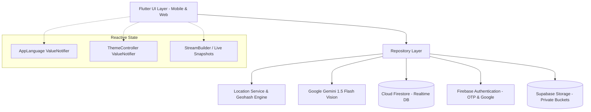

# LocaLink: Master Project Presentation & Competition Defense Guide

> **Prepared for**: Project Competition, Viva Voce & Technical Defense  
> **Project Name**: **LocaLink** — *Hyperlocal Community Services & Discovery Ecosystem*  
> **Domain**: Mobile Computing, Cross-Platform Architecture, Cloud & AI Integration  
> **Stack**: Flutter (Dart 3.x), Firebase (Auth, Firestore, Cloud Functions), Supabase Storage, Google Gemini 1.5 Flash AI, OpenStreetMap  

---

## Table of Contents
1. [Executive Summary & 2-Minute Elevator Pitch](#1-executive-summary--2-minute-elevator-pitch)
2. [Problem Statement & Market Gap in India](#2-problem-statement--market-gap-in-india)
3. [Architecture & Engineering Highlights](#3-architecture--engineering-highlights)
4. [Comprehensive Packages Breakdown (pubspec.yaml)](#4-comprehensive-packages-breakdown-pubspecyaml)
5. [Data Models, Schema & Collections](#5-data-models-schema--collections)
6. [Core Functions, Algorithms & Business Logic](#6-core-functions-algorithms--business-logic)
7. [Conditions, Validations & Concurrency Rules](#7-conditions-validations--concurrency-rules)
8. [Module-by-Module Walkthrough](#8-module-by-module-walkthrough)
9. [Top 20 Technical Viva / Judge Questions & Answers](#9-top-20-technical-viva--judge-questions--answers)
10. [Live 3-Minute Competition Demo Script](#10-live-3-minute-competition-demo-script)

---

## 1. Executive Summary & 2-Minute Elevator Pitch

### The Pitch
> *"Good morning, respected judges and professors.  
> Today, when a faucet bursts at 9 PM or an electrical switchboard short-circuits in an Indian household, what are our options?  
> Large service platforms like Urban Company focus almost exclusively on Tier-1 metro high-ticket grooming or AC servicing with high commission markups. Meanwhile, directory platforms like Justdial spam customer phone numbers across 15 vendors who cold-call endlessly without price transparency.  
> 
> **LocaLink** is our answer. It is a modern, privacy-first, hyperlocal services and discovery platform built specifically for Indian neighborhoods.  
> It connects residents with trusted local plumbers, electricians, carpenters, and neighborhood shops within a 5 km radius.  
> Key innovations include:  
> 1. **AI Visual Diagnostic Assistant**: Powered by Google Gemini 1.5 Flash multimodal vision, residents take a photo of a broken appliance or pipe to get an instant diagnosis, safety tips, realistic Indian market price estimates, and the exact trade category required.  
> 2. **Privacy Firewall & Fair Lead Marketplace**: Customer phone numbers are locked until a provider unlocks the job using prepaid wallet credits (₹25), eliminating customer spam and ensuring equal opportunity for small independent tradespeople.  
> 3. **Native Multilingual Experience**: Full real-time switching between English, Hindi, and Marathi with persistent local preference.  
> 4. **Emergency SOS & Safety First**: Integrated 1-tap SOS dialing (112) with immediate SMS broadcast of GPS coordinates.  
> 5. **Zero-Vendor Lock-in Geo Engine**: Implemented using OpenStreetMap and Geohashes, avoiding expensive proprietary mapping bills while guaranteeing sub-second spatial queries."*

---

## 2. Problem Statement & Market Gap in India

| Problem in Current Systems | How LocaLink Solves It |
| :--- | :--- |
| **Customer Spam & Data Leakage**: Lead brokers sell customer phone numbers to dozens of contractors. | **Zero-Leakage Privacy Firewall**: Sensitive phone numbers are isolated in subcollections and only revealed to the single provider who accepts the job. |
| **High Commission Gating**: Platforms take 20% to 30% cuts from unorganized blue-collar workers. | **Micro-Fee Credit Model**: Flat ₹25 per unlocked lead via digital wallet. No percentage deductions from their hard-earned labor. |
| **Technical Jargon Barrier**: Non-technical customers struggle to explain what is broken (e.g., "cartridge failure" vs "tap broken"). | **Gemini Multimodal Vision**: Instant AI diagnosis from a simple smartphone photograph. |
| **Linguistic Alienation**: Most apps are English-only, locking out local tradespeople and vernacular residents. | **Trilingual Engine**: Seamless Hindi, Marathi, and English UI strings stored locally and synced reactively. |
| **Expensive Map API Dependency**: Apps using Google Maps APIs incur exorbitant costs per map load. | **OpenStreetMap + flutter_map**: Open-source, tile-cached mapping with geohash-based spatial queries. |

---

## 3. Architecture & Engineering Highlights



### Key Architectural Patterns
1. **Clean Feature-First Architecture**: Code is structured by business domain (`features/auth`, `features/browse`, `features/requests`, `features/assistant`, `features/provider`, `features/vendor`, `features/safety_profile`), preventing monolithic spaghetti code.
2. **Repository Pattern**: Screens **never** interact directly with Firebase or Supabase APIs. All data retrieval, caching, error-handling, and fallback logic is encapsulated in repository classes (`ProviderRepository`, `BrowseRepository`, `AssistantRepository`, etc.).
3. **Dual Cloud Strategy**:
   - **Google Firebase**: Used for low-latency Realtime Firestore streams, Phone OTP/Google OAuth, and security rule enforcement.
   - **Supabase Storage**: Used for S3-compatible, private bucket binary storage (KYC proofs, trade certificates, AI diagnostic photo attachments).
4. **Resilient Offline-First Graceful Degradation**:
   - Every Firestore stream is guarded with `.handleError(...)` to gracefully fall back to cached/demo previews if network fails or permissions are restricted.
   - AI Diagnosis includes a heuristic rule-based fallback if the Gemini API quota is reached or network is offline.

---

## 4. Comprehensive Packages Breakdown (`pubspec.yaml`)

| Package | Version | Purpose in LocaLink | Why We Chose It Over Alternatives |
| :--- | :--- | :--- | :--- |
| `flutter` | SDK | Cross-platform UI toolkit | Single codebase for Android, iOS, and Web with 60 FPS Skia/Impeller rendering. |
| `firebase_core` | `^4.15.0` | Firebase project bootstrap | Official SDK for initializing Google Cloud services. |
| `firebase_auth` | `^6.7.0` | User identity & authentication | Supports Phone OTP verification and Google Sign-In with JWT session security. |
| `cloud_firestore` | `^6.10.0` | NoSQL document database | Native web socket-based real-time data sync (`snapshots()`) for live chat and job status. |
| `firebase_messaging` | `^16.7.0` | Push notifications | High-priority background alerts to providers when new nearby leads are posted. |
| `cloud_functions` | `^6.5.0` | Serverless backend compute | Executes atomic operations (lead acceptance, wallet debit) in a trusted server environment. |
| `supabase_flutter` | `^2.18.2` | Object Storage client | Private encrypted S3 buckets for large KYC document uploads without Firebase Storage limits. |
| `google_generative_ai` | `^0.4.7` | Gemini 1.5 Flash API SDK | Official Google AI SDK for multimodal vision input (photos + structured JSON output). |
| `flutter_map` | `^8.3.2` | OpenStreetMap canvas | High-performance raster/vector map rendering without Google Maps API keys or per-load billing. |
| `latlong2` | `^0.10.1` | Geospatial mathematics | Computes Haversine distance calculations and bounding box coordinates. |
| `geolocator` | `^14.1.1` | Device GPS interface | Fetches hardware coordinates with battery-efficient accuracy and timeout safeguards. |
| `geocoding` | `^4.0.0` | Reverse geocoding | Translates raw latitude/longitude coordinates into human-readable area names (e.g., "Shivajinagar, Pune"). |
| `geoflutterfire_plus`| `^0.0.34`| Geohash indexing | Encodes GPS coordinates into Base32 geohash strings for efficient range queries in Firestore. |
| `image_picker` | `^1.2.4` | Media selector | Hardware camera capture and gallery selection across mobile and Web. |
| `google_fonts` | `^9.0.0` | Custom typography | Modern, readable Plus Jakarta Sans typography tailored for mobile interfaces. |
| `cached_network_image`| `^4.0.4` | Image caching & shimmer | Caches downloaded vendor signboards and listing images in local disk memory. |
| `shared_preferences` | `^2.5.6` | Key-value disk persistence | Stores language selection (en/hi/mr) and theme preferences across app restarts. |
| `url_launcher` | `^6.3.3` | OS intent launcher | Directly opens native phone dialer for Emergency SOS (`112`) and customer-provider phone calls. |
| `intl` | `^0.20.3` | Internationalization | Formats Indian Rupee currency (₹) and localized date/time timestamps. |

---

## 5. Data Models, Schema & Collections

### 1. `users/{uid}`
- `uid` *(string)*: Unique Firebase Auth identifier.
- `role` *(string)*: `'customer'` | `'provider'` | `'vendor'`.
- `phone` *(string)*: Verified phone number (`+91...`).
- `displayName` *(string)*: Full name.
- `preferredLanguage` *(string)*: `'en'` | `'hi'` | `'mr'`.
- `createdAt` *(timestamp)*: Account creation date.

### 2. `listings/{listingId}`
- `id` *(string)*: Document ID.
- `ownerId` *(string)*: Associated provider or vendor UID.
- `name` *(string)*: Shop or business title.
- `category` *(string)*: Trade category (`Plumber`, `Electrician`, `Hardware`, etc.).
- `address` *(string)*: Street address.
- `geopoint` *(GeoPoint)*: Latitude & Longitude.
- `geohash` *(string)*: Base32 geohash string for proximity filtering.
- `averageRating` *(number)*: 0.0 to 5.0 rating.
- `reviewCount` *(integer)*: Total verified reviews.
- `verified` *(boolean)*: True if KYC documents approved.

### 3. `leads/{leadId}` (`leads/{requestId_providerId}`)
- `id` *(string)*: Composite key of `requestId_providerId`.
- `requestId` *(string)*: Parent service request document ID.
- `providerId` *(string)*: Targeted provider UID.
- `category` *(string)*: Job category.
- `summary` *(string)*: Description of work.
- `areaLabel` *(string)*: Rough neighborhood (e.g., "Kothrud, Pune").
- `distanceM` *(number)*: Distance in meters from provider's service location.
- `fee` *(integer)*: Credits deducted upon acceptance (Default: ₹25).
- `status` *(string)*: `'new'` | `'viewed'` | `'accepted'` | `'declined'` | `'expired'`.

### 4. `requests/{requestId}`
- `id` *(string)*: Unique request ID.
- `customerId` *(string)*: Customer UID.
- `providerId` *(string?)*: Assigned provider UID (null while finding).
- `category` *(string)*: Trade type.
- `description` *(string)*: Problem description.
- `status` *(string)*: `'finding'` | `'accepted'` | `'in_progress'` | `'completed'` | `'cancelled'`.
- `createdAt` *(timestamp)*: Creation time.
- **Subcollection**: `requests/{requestId}/private/contact` *(Locked by Firestore Security Rules)*:
  - `customerName` *(string)*
  - `phone` *(string)*
  - `exactAddress` *(string)*

### 5. `wallets/{providerId}`
- `balance` *(integer)*: Available balance in Rupees / credits.
- `updatedAt` *(timestamp)*: Last transaction timestamp.
- **Subcollection**: `wallets/{providerId}/transactions/{txId}`:
  - `amount` *(number)*: Positive for top-up, negative for lead fee.
  - `type` *(string)*: `'topup'` | `'lead_unlock'` | `'refund'`.
  - `description` *(string)*: Transaction note.

### 6. `ai_sessions/{sessionId}`
- `sessionId` *(string)*: Unique diagnostic session ID.
- `userId` *(string)*: Customer UID or `'guest'`.
- `problemTitle` *(string)*: Generated title (e.g., "Corroded Brass Pipe Leak").
- `category` *(string)*: Predicted trade category.
- `diagnosis` *(string)*: Technical explanation of the fault.
- `safetyTips` *(string)*: Precautionary action (e.g., "Shut off main water valve").
- `estimatedCostMin` / `estimatedCostMax` *(integers)*: Estimated cost in INR (₹).
- `urgency` *(string)*: `'now'` | `'today'` | `'schedule'`.

---

## 6. Core Functions, Algorithms & Business Logic

### 1. Spatial Proximity Search via Geohash (Haversine & Bounding Box)
Rather than executing slow $O(N)$ distance calculations on millions of records, LocaLink computes a **Base32 Geohash** prefix for the user's location.
- In `BrowseRepository.fetchNearbyListings()`:
  - Queries Firestore with `where('geohash', '>=', lowerBound).where('geohash', '<=', upperBound)`.
  - This utilizes Firestore B-Tree indexes to retrieve only candidates in that geographic rectangle.
  - Computes exact Haversine distance in memory:
    $$d = 2r \arcsin\left(\sqrt{\sin^2\left(\frac{\Delta \phi}{2}\right) + \cos(\phi_1)\cos(\phi_2)\sin^2\left(\frac{\Delta \lambda}{2}\right)}\right)$$
  - Filters out anything outside the specified radius (e.g., 5 km) and sorts by nearest first.

### 2. Gemini 1.5 Flash Multimodal Vision Pipeline
- Located in `AssistantRepository.diagnoseIssue()`:
  - Takes raw compressed image bytes (`Uint8List`).
  - Sends a payload with a strict JSON Schema instruction to `gemini-1.5-flash`.
  - Parses structured output: `problemTitle`, `category`, `diagnosis`, `safetyTips`, `estimatedCostMin`, `estimatedCostMax`.
  - **Graceful Fallback**: If internet is down or API quota is exceeded, activates `_generateHeuristicDiagnosis()` to inspect user text keywords and provide realistic home repair recommendations.

### 3. Concurrency-Safe Lead Acceptance
- Problem: Two providers might click "Accept Job" on the same lead simultaneously.
- Solution in `ProviderRepository.acceptLead()`:
  - Executes inside a Firestore Transaction or Cloud Function.
  - Reads `requests/{requestId}`: if status is already `'accepted'`, aborts immediately with `AcceptLeadResult.alreadyTaken`.
  - If still `'finding'`, atomically:
    1. Updates `requests/{requestId}.status = 'accepted'` and sets `providerId = currentUser.uid`.
    2. Updates `leads/{id}.status = 'accepted'`.
    3. Deducts ₹25 from `wallets/{providerId}.balance`.
    4. Unlocks `requests/{requestId}/private/contact` for that provider.

### 4. Dynamic Tri-Lingual Localization Engine
- Implemented in `AppLanguage` (`core/localization/app_language.dart`):
  - Uses `ValueNotifier<String>` holding active language code (`'en'`, `'hi'`, `'mr'`).
  - Preloaded dictionary of localized string tokens for UI labels.
  - Changes instantly update all widgets through `ValueListenableBuilder` without restarting the app.
  - Saves choice to `SharedPreferences` so language persists on cold boot.

---

## 7. Conditions, Validations & Concurrency Rules

1. **Wallet Balance Threshold**:
   - Condition: Provider wallet balance must be $\ge$ lead fee (₹25).
   - If balance < ₹25, the "Accept Lead" button redirects to the `WalletView` top-up screen.
2. **Customer Privacy Isolation**:
   - Condition: Provider can **never** see customer phone number or street address while lead status is `'new'` or `'declined'`.
   - Firestore security rules reject read attempts to `requests/{id}/private` unless `request.auth.uid == resource.data.providerId`.
3. **Double-Click / Race Condition Protection**:
   - Condition: `_isSubmitting` / `_isLoading` flags disable buttons immediately on first tap to prevent multiple API dispatches.
4. **Web Image Safety Condition**:
   - Condition: On Flutter Web, `dart:io` `File` is forbidden.
   - Code strictly parses files as `Uint8List` using `picked.readAsBytes()` and displays with `Image.memory()`.
5. **GPS Hardware Timeout**:
   - Condition: Hardware GPS search has an enforced 12-second timeout.
   - If GPS fails, user is transitioned smoothly to the OpenStreetMap interactive location picker.

---

## 8. Module-by-Module Walkthrough

```
┌────────────────────────────────────────────────────────┐
│                      LOCALINK APP                      │
├──────────────────────────┬─────────────────────────────┤
│ CUSTOMER MODULES         │ PROVIDER & VENDOR MODULES   │
│ 1. Auth & Language       │ 6. Provider Portal          │
│    (OTP, Google, hi/mr)  │    (Lead Inbox, Wallet)     │
│ 2. Hyperlocal Browse     │ 7. Vendor / Shop Hub        │
│    (Nearby, Maps, Search)│    (Claim Shop, Inventory)  │
│ 3. Service Booking       │                             │
│    (Live radar, Tracking)│ SAFETY & UTILITIES          │
│ 4. Gemini AI Diagnosis   │ 5. Emergency SOS (112 dial) │
│    (Multimodal repair)   │    New to City Checklist    │
└──────────────────────────┴─────────────────────────────┘
```

- **Module 1 (Auth & Onboarding)**: Phone OTP and Google Sign-In with instant language selector (English, हिन्दी, मराठी).
- **Module 2 (Browse)**: Category grid, verified badges, rating stars, search bar, and interactive map with shop pins.
- **Module 3 (Requests & Booking)**: Job description input, urgency tags, live radar animation while searching for providers, in-app messaging, and service completion confirmation.
- **Module 4 (AI Diagnostic Assistant)**: Photo upload/capture, Gemini 1.5 Flash diagnosis, estimated cost breakdown, and New to City relocation checklist.
- **Module 5 (Safety & Emergency)**: Instant emergency SOS dialer triggering `112`, safety audit checklist, and user profile management.
- **Module 6 (Service Provider)**: Availability toggle (Online/Offline), incoming lead inbox with distance & fee badges, 1-tap accept, customer contact view, and digital wallet.
- **Module 7 (Vendor / Place Owner)**: Business profile, product catalog management, and ownership claim workflow.

---

## 9. Top 20 Technical Viva / Judge Questions & Answers

### Architecture & Framework
#### Q1: "Why did you choose Flutter over native Android (Kotlin) or React Native?"
> **Answer**:  
> *"Flutter compiles to native ARM machine code via Dart, delivering consistent 60–120 FPS performance across Android, iOS, and Web from a single codebase. Compared to React Native, Flutter eliminates the JavaScript-to-Native bridge, preventing UI jank during complex gesture animations like interactive maps. For an Indian neighborhood app where rapid cross-platform deployment and vernacular rendering are vital, Flutter's unified rendering engine is unbeatable."*

#### Q2: "Why combine Firebase and Supabase in the same project instead of using only one?"
> **Answer**:  
> *"We leveraged the distinct architectural strengths of both platforms:  
> Firebase is industry-leading for real-time document sync (`cloud_firestore` streams) and seamless Phone OTP authentication.  
> However, for large binary storage (provider KYC documents, business registrations, AI photos), Supabase provides S3-compatible, cost-effective Object Storage with clear bucket policies. This dual-backend approach keeps our real-time database lean while storing sensitive files securely in private buckets."*

#### Q3: "What state management pattern did you use and why?"
> **Answer**:  
> *"We utilized a lightweight, reactive combination of `ValueNotifier` / `ValueListenableBuilder` alongside native `StreamBuilder`.  
> For global states like language selection (`AppLanguage`) and theme switching (`ThemeController`), `ValueNotifier` provides O(1) rebuilds with zero external boilerplate. For real-time updates like provider lead inboxes and chat messages, we stream directly from Firestore. This keeps the application memory footprint minimal without the overhead of heavy third-party state libraries."*

---

### Proximity & Database
#### Q4: "How does your nearby search work? Does it scan every document in the database?"
> **Answer**:  
> *"No, a full-table scan would be computationally expensive and cost-prohibitive. We use **Geohashes** via `geoflutterfire_plus`.  
> A geohash divides the world into hierarchical bounding boxes encoded as base32 strings. When a user searches for plumbers within 5 km, we compute the bounding geohash query range (`where geohash >= start and geohash <= end`). Firestore uses its B-Tree index to only read documents in those sectors. Then, in memory, we execute the Haversine formula to calculate precise distance down to the meter."*

#### Q5: "Why did you use OpenStreetMap (`flutter_map`) instead of Google Maps SDK?"
> **Answer**:  
> *"Google Maps API costs $7 per 1,000 map loads after a modest quota, which is not economically viable for high-traffic, low-margin community platforms in emerging markets.  
> By utilizing `flutter_map` with OpenStreetMap tile layers, our mapping infrastructure is 100% open-source, tile-cached, and free of proprietary API billing, while providing full interactive pan, zoom, and custom marker pins."*

---

### AI & Multimodal Vision
#### Q6: "How does the AI Assistant diagnose broken items? What model is used?"
> **Answer**:  
> *"We integrated Google's **Gemini 1.5 Flash** multimodal model via the `google_generative_ai` SDK.  
> When the user snaps a photo, the image is compressed and passed as raw bytes (`Uint8List`) alongside a system prompt instructing the model to respond strictly in JSON matching our schema: title, trade category, diagnostic summary, safety instructions, and INR price estimates. If the API is unreachable, a heuristic fallback analyzes user text keywords so the user is never left without guidance."*

#### Q7: "What happens if Gemini hallucinates or returns invalid data?"
> **Answer**:  
> *"First, we enforce a strict JSON schema prompt with specific temperature controls. Second, the JSON response is wrapped in a `try/catch` parser with typed model validation (`AiSession.fromMap`). If the model output deviates or fails schema validation, the system gracefully engages our rule-based heuristic engine, ensuring the app never crashes or presents malformed data."*

---

### Concurrency & Security
#### Q8: "What happens if two plumbers click 'Accept Lead' on the exact same job at the exact same second?"
> **Answer**:  
> *"We prevent race conditions through atomic server-side transactions. The first transaction to reach the database reads the lead status as `'new'`, locks it, changes the status to `'accepted'`, and deducts the ₹25 fee.  
> When the second provider's concurrent transaction arrives, the condition check fails because the status is no longer `'new'`. The database rolls back, no wallet credits are deducted, and the second provider receives a polite 'Lead Already Taken' notification."*

#### Q9: "How do you protect customer phone numbers from telemarketing spam?"
> **Answer**:  
> *"Through our **Two-Tier Privacy Quarantine**. When a customer posts a request, public details (category, rough area, problem summary) are stored in `requests/{id}`. However, sensitive personal info (full name, phone number, door address) is stored in a separate subcollection at `requests/{id}/private/contact`.  
> Our Firestore Security Rules enforce that reading from `private/contact` is restricted: only the customer who created it and the single provider whose UID is stamped in `requests/{id}.providerId` can read it."*

#### Q10: "Can a malicious user modify their wallet balance directly in Firestore?"
> **Answer**:  
> *"No. Our Firestore Security Rules explicitly contain `allow write: if false;` on the `wallets` collection for clients. Wallet top-ups and lead fee deductions are strictly restricted to trusted backend Cloud Functions or administrative service accounts. Even if someone intercepts our network calls, client-side writes to balances will be rejected by the database."*

---

### Reliability & Edge Cases
#### Q11: "What happens if the device is offline or has poor cellular connectivity?"
> **Answer**:  
> *"Firestore maintains an offline cache by default, serving previously loaded listings and profile data when offline. In our repository layer, all streams feature `.handleError(...)` catches that supply sensible fallback previews instead of crashing. Network calls enforce a 15-second timeout (`Env.requestTimeout`) to prevent infinite hanging spinners."*

#### Q12: "Why did image picking fail on Flutter Web previously, and how did you resolve it?"
> **Answer**:  
> *"On Flutter Web, native operating system file descriptors do not exist; browsers use sandbox `blob:` URLs. Attempting to use `dart:io`'s `File` or `Image.file` throws an unsupported operation exception that halts widget layout and triggers hit-test failures.  
> We solved this by removing `dart:io` entirely from web paths, extracting image bytes directly into `Uint8List` using `picked.readAsBytes()`, and displaying them via `Image.memory()`, which works uniformly across all target platforms."*

---

### Business Model & Social Impact
#### Q13: "What is the business and revenue model of LocaLink?"
> **Answer**:  
> *"LocaLink operates on a transparent, pro-worker micro-transaction model:  
> 1. **Pay-Per-Lead Unlock**: Providers pay a nominal flat fee (₹25) to unlock a customer's verified contact details. Unlike competitors taking 20-30% of total job cost, providers keep 100% of their earnings.  
> 2. **Featured Shop Subscriptions**: Local hardware stores and merchants pay a modest monthly fee (e.g., ₹299/month) for priority placement in neighborhood search results.  
> 3. **Verified Badge Onboarding**: Optional background verification and trade skills badge for premium trust."*

#### Q14: "How does LocaLink support non-English speaking blue-collar tradespeople?"
> **Answer**:  
> *"LocaLink includes a complete vernacular localization system supporting Hindi and Marathi. Providers can toggle their language with a single tap. All status labels, lead summaries, navigation icons, and wallet alerts are fully translated, ensuring zero linguistic barrier for local workers."*

#### Q15: "How does the Emergency SOS feature work?"
> **Answer**:  
> *"In high-stress situations, users cannot navigate complex menus. The SOS button is prominently pinned in the app bar. Tapping it triggers our emergency sequence: it immediately launches the device dialer to India's national emergency hotline (`112`) via `url_launcher` and formats a pre-composed SMS with the user's exact reverse-geocoded GPS address for immediate dispatch to emergency contacts."*

---

## 10. Live 3-Minute Competition Demo Script

Follow this step-by-step sequence during your live presentation to wow the judges:

### Step 1: Onboarding & Vernacular Switching (0:00 - 0:45)
1. Launch the app on your phone/browser.
2. Point out the clean splash screen transitioning into the **Language Selector**.
3. Tap **"हिन्दी"** or **"मराठी"** &rarr; Show the judges how the entire UI seamlessly re-renders in real-time without reloading the screen.
4. Explain: *"Our app is built for Bharat. A local electrician in Pune can navigate entirely in Marathi or Hindi."*

### Step 2: AI Diagnostic Assistant Demo (0:45 - 1:30)
1. Navigate to **AI Assistant** &rarr; Tap **"Diagnose Problem"**.
2. Tap **"Use Demo Photo"** (or take a quick photo of a pipe/switch).
3. Tap **"Analyze with Gemini AI"**.
4. Show the AI Result screen:
   - Highlight the detected issue: *"Bathroom pipe leakage"*.
   - Highlight the Trade Recommendation: *"Plumber"*.
   - Highlight the **Emergency Safety Tip**: *"Shut off main valve"*.
   - Highlight the realistic **Price Estimate**: *"₹250 - ₹500"*.
5. Explain: *"This prevents customers from being overcharged and ensures the right specialist is booked."*

### Step 3: Hyperlocal Search & OpenStreetMap (1:30 - 2:15)
1. Tap the **Browse** tab.
2. Show the category cards (Plumbing, Electrical, Carpentry, Hardware).
3. Tap the **Map View** toggle:
   - Point out the neighborhood map pins loading dynamically from our spatial geohash query.
   - Show how it calculates distance (e.g., *"1.2 km away"*).
4. Explain: *"We use open-source OpenStreetMap tiles. Zero dependency on expensive Google Maps billing."*

### Step 4: Provider Marketplace & Privacy Defense (2:15 - 3:00)
1. Open the **Provider Dashboard** / **Lead Inbox**.
2. Show the incoming lead card:
   - Note that it displays the rough area (`Model Colony, Pune`), category, and fee (`₹25`), but the customer's phone number is securely masked.
3. Tap **"Accept Lead"**:
   - Show the atomic wallet deduction (₹25).
   - Show how the customer's direct call button and exact address are unlocked.
4. Conclude with impact: *"LocaLink delivers privacy for the customer, zero commission for the provider, and AI-powered intelligence for everyone. Thank you, and we welcome your questions!"*
